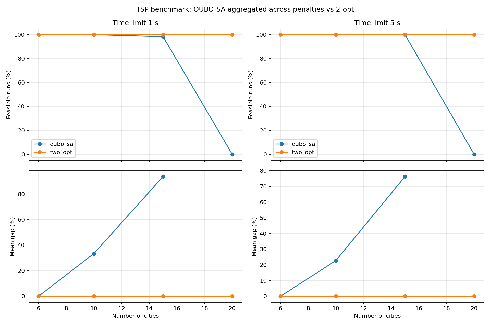
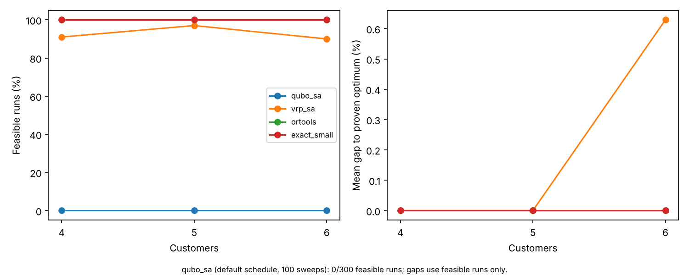

[](https://www.python.org/)
[](LICENSE)
[](https://github.com/abdulazizbalu/quasar-solver/actions/workflows/tests.yml)

<p align="center">
  <strong><a href="https://abdulazizbalu.github.io/quasar-solver/demos/web_demo.html">Route visualization demo</a></strong>
</p>

# Quasar Solver

Quasar Solver is a Python research package for QUBO simulated annealing and small routing experiments. It includes TSP, capacitated vehicle routing (CVRP), and vehicle routing with time windows (VRPTW), with independent feasibility checks and classical reference solvers. The VRP QUBO is restricted to tiny CVRP instances.

## Installation

```bash
pip install -e .
```

For development (the test suite needs OR-Tools):

```bash
pip install -e ".[dev,vrp]"
```

## Route visualization demo

The linked demo is a standalone JavaScript 2-opt annealer; it does not run the Python QUBO solver. Open it in a browser, place cities, and watch its route visualization.

## Quick Usage

```python
from quasar_solver import QUBO, SimulatedAnnealingSolver
q = QUBO(); q.add(0, 0, -1.0); q.add(1, 1, 2.0)
result = SimulatedAnnealingSolver(seed=42).solve(q)
```

## TSP Demo

The routing demo builds a seeded six-city symmetric distance matrix, converts it to a QUBO with one-hot Travelling Salesman Problem constraints, and solves it with simulated annealing. It prints the best energy, decoded tour, and total route distance when the best sample is valid.

Run it with:

```bash
python demos/routing_demo.py
```

The demo saves a plot of the city coordinates and decoded route to `demos/tour.png`. If the annealer returns an invalid one-hot assignment, the demo prints a warning and still saves the city plot.

## Roadmap

- Schedule optimization
- Financial portfolio demo
- Web UI

## How It Works

QUBO formulation turns an optimization problem into a polynomial over binary variables. Each variable can be either 0 or 1, and the model assigns costs to individual variables and pairs of variables. Hard constraints are usually represented as large penalty terms, so invalid assignments become expensive. Once a problem is in QUBO form, many different search methods can try to minimize its energy.

Simulated annealing is a randomized search method inspired by cooling physical systems. It starts from a random binary sample, flips bits one at a time, and keeps changes that improve the energy. It can also accept worse moves early in the run, which helps it escape shallow local minima. As the temperature cools, the solver becomes more selective and settles into its best-found solution.

For TSP, `QuboSASwapSolver` anneals the same QUBO energy while representing each state as a tour. It holds city 0 at position 0 and proposes swaps of two other cities, so each state remains a valid permutation. Its move cost is computed from the affected tour edges.

## Benchmarks

Run `python -m benchmarks.run_benchmarks` from the repository root to reproduce the raw results, summary, paired comparisons, and chart. Each size has ten seeded Euclidean instances (instance seeds 202600–202609), and each instance has ten solver seeds (0–9). The reference for **every** instance, including 15 and 20 cities, is the proven Held–Karp optimum computed by float64 subset dynamic programming. Raw observations are in [`benchmarks/results/raw.csv`](benchmarks/results/raw.csv); the full tables and confidence intervals are in [`benchmarks/results/summary.md`](benchmarks/results/summary.md).

All three methods receive one read of 100 sweeps, with `100 × n²` attempted operations per run: 3,600, 10,000, 22,500, and 40,000 at 6, 10, 15, and 20 cities. This is `100n` attempts per city. Bit-flip QUBO-SA counts attempted bit flips, permutation-preserving `qubo_sa_swap` counts proposed city swaps, and multi-start `two_opt` counts evaluated tour moves. These operations have different computational costs, so equal counts do not imply equal wall time. A wall-clock limit is available as a secondary cap; it was not used for these results. Mean gaps use feasible runs; the 95% confidence intervals resample the ten independent instances. Measurements were collected with Python 3.14.4 on an Intel64 Family 6 Model 186 Stepping 3 CPU, Windows 11.

| Cities | Solver | Feasible | Mean gap to proven optimum [95% CI] | Attempts | Mean runtime |
| ---: | --- | ---: | ---: | ---: | ---: |
| 6 | qubo_sa | 100/100 | 4.14% [2.72, 5.63] | 3,600 | 0.0424 s |
| 6 | qubo_sa_swap | 100/100 | 0.00% [0.00, 0.00] | 3,600 | 0.0612 s |
| 6 | two_opt | 100/100 | 0.00% [0.00, 0.00] | 3,600 | 0.0365 s |
| 10 | qubo_sa | 99/100 | 32.87% [29.06, 36.61] | 10,000 | 0.1584 s |
| 10 | qubo_sa_swap | 100/100 | 0.27% [0.00, 0.65] | 10,000 | 0.2173 s |
| 10 | two_opt | 100/100 | 0.41% [0.00, 1.23] | 10,000 | 0.1282 s |
| 15 | qubo_sa | 98/100 | 65.22% [60.56, 69.91] | 22,500 | 0.3930 s |
| 15 | qubo_sa_swap | 100/100 | 1.43% [0.52, 2.49] | 22,500 | 0.5060 s |
| 15 | two_opt | 100/100 | 0.00% [0.00, 0.00] | 22,500 | 0.3630 s |
| 20 | qubo_sa | 98/100 | 86.65% [77.37, 95.89] | 40,000 | 0.7410 s |
| 20 | qubo_sa_swap | 100/100 | 3.69% [2.59, 4.97] | 40,000 | 0.9126 s |
| 20 | two_opt | 100/100 | 0.37% [0.00, 1.08] | 40,000 | 0.8145 s |



### Swap schedule tuning

Run `python -m benchmarks.tune_swap` to reproduce the cooling-schedule experiment. It uses instance seeds 303000–303001 and solver seeds 100–102, disjoint from the benchmark. Four schedules were compared over 24 runs each at the same `100 × n²` proposal budget. The lowest aggregate mean gap, 1.698%, came from inverse-temperature endpoints 1 and 30 divided by `max_distance`; the other tested schedules scored 3.225%, 1.879%, and 3.538%. The selected schedule is fixed in `qubo_sa_swap` and in the benchmark. See the [tuning table](benchmarks/results/swap_tuning.md) and [raw tuning results](benchmarks/results/swap_tuning.csv).

### Findings

- Swap moves keep the one-hot assignment valid: all 400 swap runs returned feasible tours, compared with 395/400 bit-flip runs. A swap changes four one-hot bits but leaves the constraint penalty constant, so its energy change comes from the affected tour edges.
- At 20 cities, the swap mean gap is 3.69%, down 82.96 percentage points from bit-flip SA's 86.65%. It remains 3.32 percentage points above 2-opt's 0.37%. At 15 cities, swap is 1.43 percentage points above 2-opt. At 6 cities the two methods tie at the optimum; at 10 cities swap's 0.27% mean gap is 0.14 percentage points below 2-opt's 0.41%, a small difference in these runs.
- The 20-city bit-flip result changed from Phase 1b's 86.03% gap (commit 7c46285) to 86.65% because the reference is now the proven optimum rather than the experiment's best found tour. The exact reference also exposes 2-opt's 0.37% gap at 20 cities. These are changes in the denominator, not improvements in those solvers.
- Under equal attempt counts, swap SA took more wall time than 2-opt at every tested size. The QUBO contains `n²` binary variables (400 at 20 cities); the swap solver avoids invalid states but still builds that QUBO once per run. The measured gap and runtime therefore do not establish an advantage over 2-opt.

### Scope and limits

`qubo_sa_swap` uses the QUBO to define energy, but its moves swap two cities in a tour. Each move flips four one-hot bits at once and leaves the constraint penalty constant. A generic QUBO annealer or quantum hardware running the plain QUBO does not make this move. It is a classical permutation heuristic, so its results do not establish that one-hot QUBO annealing works for TSP.

The `qubo_sa` bit-flip results show what a plain QUBO solver encounters: feasibility below 100% and a gap that grows quickly with size. These runs are consistent with the penalty encoding and one-bit moves being limiting, but they do not isolate the cause.

Multi-start 2-opt remains the stronger routing baseline in these experiments. The swap solver also took more wall time under equal attempt counts.

These instances are random Euclidean TSP with at most 20 cities. The results do not establish performance on larger instances or other problem classes.

The main TSP table continues to use the historical coefficient_scaled_linear default; the separately labeled penalty-scaled schedule experiment is reported in the [external sampler comparison](benchmarks/results/external_comparison_summary.md), not mixed into the main TSP table. A fresh default-schedule rerun confirmed identical feasibility, objective, and gap for all seeded runs; the measured runtime comparison is in [the verification report](benchmarks/results/tsp_schedule_verification.md).

## Vehicle routing (CVRP and VRPTW)

`CVRPInstance` stores demands, capacity, fleet size (or unlimited), and a distance matrix with depot node 0. `VRPTWInstance` adds time windows and service times. VRP results store multiple routes in `Solution.routes`; `Solution.route` remains empty for this interface. `is_feasible_vrp` independently checks visits, capacity, fleet size, depot endpoints, and time windows. `exact_small` uses CP-SAT and reports a proven optimum only when its status is `OPTIMAL`. `vrp_sa` is a classical route-structure annealer. Tiny-CVRP `qubo_sa` uses one-hot assignment/order variables with capacity slack bits and is deliberately capped at six customers (at most 92 variables in these instances).

Run the complete route benchmark and the separate QUBO budget sweep from the repository root:

```bash
pip install -e ".[dev,vrp]"
python -m benchmarks.run_vrp_benchmarks
```

The command downloads checksum-verified files to ignored `benchmarks/data/vrp/` and writes raw rows, environment metadata, summaries, and charts. No third-party instance files are redistributed. Tiny cases use 10 random Euclidean instances per size (4, 5, 6), integer demands in 1–3, alternating five tight and five loose capacities, and 10 solver seeds per instance. Instances are independent within a size; the same instance seed is reused across sizes, so a smaller instance shares its first nodes with the larger one. The CP-SAT reference is proven for each generated instance. Tiny route solvers share a 0.2-second deadline; standard `vrp_sa` and OR-Tools share a 1-second deadline. For OR-Tools, `random_seed` does not affect RoutingSearch. The recorded seed instead selects one of six first-solution strategies (seed mod 6), so seeds 6–9 repeat the strategies of seeds 0–3 and those four strategies carry double weight in OR-Tools means; the search is time limited, so runtime varies slightly across reruns. `vrp_sa` in time mode cools over a fixed 100 attempts per customer and then continues at its final temperature until the deadline, so its attempt counts and results depend on machine speed.

The primary tiny-CVRP QUBO settings use 100 sweeps, or 100 attempted flips per binary variable, with a 5-second secondary cap. `vrp_sa` continues until the same 0.2-second deadline as OR-Tools. This primary comparison shows the 100-sweep setting; the full schedule-by-budget study is in [the QUBO sweep report](benchmarks/results/vrp_qubo_budget_sweep.md), [raw CSV](benchmarks/results/vrp_qubo_budget_sweep.csv), and [chart](docs/vrp_qubo_budget_sweep.png). The historical `coefficient_scaled_linear` schedule remains the default. The explicit `penalty_scaled_geometric` schedule starts at temperature `8P` and cools geometrically to `0.05P`, where `P` is the constraint penalty.

The default schedule does not suit this CVRP encoding. It ends at temperature `max|Q|/10`, and squaring the capacity equation with binary slack bits makes the largest coefficient 10–144 times `P` on these instances, so the run ends at 1.0–14.4 `P`: constraint violations stay thermally accessible to the end. On TSP the same schedule ends at 0.2 `P`. The [scale diagnostic](benchmarks/results/qubo_scale_diagnostic.md) (`python -m benchmarks.qubo_scale_diagnostic`) lists these ratios per instance set. The primary table therefore mostly shows this schedule mismatch, not the best this QUBO can do; the penalty-scaled results are in the sweep and in the external comparison below.

### Tiny CVRP: 100-sweep primary setting

| Customers | Solver | Feasible | Mean gap on feasible runs [95% CI] | QUBO variables |
| ---: | --- | ---: | ---: | ---: |
| 4 | `qubo_sa` | 0/100 | n/a | 44–48 |
| 4 | `vrp_sa` | 91/100 | 0.00% [0.00, 0.00] | — |
| 4 | OR-Tools | 100/100 | 0.00% [0.00, 0.00] | — |
| 4 | `exact_small` | 100/100 | 0.00% [0.00, 0.00] | — |
| 5 | `qubo_sa` | 0/100 | n/a | 66–68 |
| 5 | `vrp_sa` | 97/100 | 0.00% [0.00, 0.00] | — |
| 5 | OR-Tools | 100/100 | 0.00% [0.00, 0.00] | — |
| 5 | `exact_small` | 100/100 | 0.00% [0.00, 0.00] | — |
| 6 | `qubo_sa` | 0/100 | n/a | 90–92 |
| 6 | `vrp_sa` | 90/100 | 0.63% [0.00, 1.89] | — |
| 6 | OR-Tools | 100/100 | 0.00% [0.00, 0.00] | — |
| 6 | `exact_small` | 100/100 | 0.00% [0.00, 0.00] | — |

`qubo_sa` here uses the default `coefficient_scaled_linear` schedule (see above). Every infeasible `vrp_sa` run (9, 3 and 10 runs at 4, 5 and 6 customers) stopped in its randomized greedy construction, which found no capacity-feasible start; no annealing ran in those runs. Gaps average feasible runs within each instance, then across instances.

### Standard CVRP and VRPTW references

| Instance | Published reference | Solver | Feasible | Fleet matches | Mean distance gap on matching fleet | Median distance gap, all feasible runs (any fleet) |
| --- | ---: | --- | ---: | ---: | ---: | ---: |
| A-n32-k5 | 784 | OR-Tools | 10/10 | 10/10 | 1.03% | 0.00% |
| A-n32-k5 | 784 | `vrp_sa` | 10/10 | 10/10 | 22.72% | 22.58% |
| A-n33-k5 | 661 | OR-Tools | 10/10 | 10/10 | 3.69% | 2.57% |
| A-n33-k5 | 661 | `vrp_sa` | 10/10 | 10/10 | 17.66% | 15.73% |
| A-n37-k5 | 669 | OR-Tools | 10/10 | 10/10 | 2.18% | 2.24% |
| A-n37-k5 | 669 | `vrp_sa` | 10/10 | 10/10 | 27.62% | 27.88% |
| C101-25 | 3 vehicles, 191.3 | OR-Tools | 10/10 | 10/10 | 0.00% | 0.00% |
| C101-25 | 3 vehicles, 191.3 | `vrp_sa` | 10/10 | 3/10 | 14.04% | 32.23% |
| R101-25 | 8 vehicles, 617.1 | OR-Tools | 10/10 | 10/10 | 1.52% | 2.03% |
| R101-25 | 8 vehicles, 617.1 | `vrp_sa` | 10/10 | 8/10 | 3.22% | 2.96% |
| RC101-25 | 4 vehicles, 461.1 | OR-Tools | 10/10 | 10/10 | 0.00% | 0.00% |
| RC101-25 | 4 vehicles, 461.1 | `vrp_sa` | 10/10 | 0/10 | n/a | 7.28% |

The last column ignores fleet size. Solomon references rank fleet size before distance, so a run with more vehicles than the reference is not comparable on distance. `vrp_sa` matched the reference fleet in **no** RC101 run (all used more than 4 vehicles); its 7.28% median compares those larger-fleet solutions with a 4-vehicle reference distance and is not a valid gap under the fleet-first objective. The same caveat applies to the two R101 runs and seven C101 runs that used a different fleet.

The published Augerat CVRP values come from the [CVRPLIB reference table](https://galgos.inf.puc-rio.br/cvrplib/en/instances/1). Solomon’s original VRPTW benchmark is described in [Solomon (1987)](https://doi.org/10.1287/opre.35.2.254). The 25-customer distances here are from [Pisinger and Ropke, Table 19](https://backend.orbit.dtu.dk/ws/portalfiles/portal/3154462/A%20general%20heuristic%20for%20vehicle%20routing%20problems_TechRep_Pisinger_Ropke.pdf), with fleet counts cross-checked against [Table 6 in this comparison](https://pmc.ncbi.nlm.nih.gov/articles/PMC11784799/); the benchmark is also described by [SINTEF](https://www.sintef.no/projectweb/top/vrptw/solomon-benchmark/). These 25-customer references are distance-minimizing values and here coincide with the fleet-first references. They are cited, not re-proven. The Solomon files come from the Solomon100 mirror maintained at [BUAAxyf/Solomon100](https://github.com/BUAAxyf/Solomon100/tree/23f7cf053cc7c0a7740de246791df3ece179c8df/data/solomon_100); the benchmark data originate with Solomon (1987). No files are redistributed, and the downloader pins the mirror revision and verifies each file’s SHA-256.



### VRP findings

The primary 100-sweep QUBO configuration with the default schedule produced no feasible route in 300 runs; as explained above, that schedule ends hotter than the penalty on every instance. Before random demands were introduced (commit 5283375: unit demands, capacity `⌊m/2⌋`), the same configuration was feasible in 40/100 runs at 4 customers and 1/100 at 6; on those instances the default ended at 0.5–0.8 `P` (scale diagnostic). The default schedule's code did not change between the two releases; the drop to 0/100 coincides with the new instances and their larger coefficient ratio.

In the independent budget sweep (one annealer seed per instance, 10 instances per cell), at 10,000 sweeps per variable the penalty-scaled schedule was feasible on 9/10, 7/10 and 3/10 instances at 4, 5 and 6 customers (95% Wilson intervals 60–98%, 40–89%, 11–60%); the default schedule on 1/10, 0/10 and 0/10. Gaps on the feasible penalty-scaled runs averaged 12.6% (n=9), 23.9% (n=7) and 18.7% (n=3), and 5/10, 2/10 and 0/10 runs hit the proven optimum. Because these gaps average different numbers of feasible runs, they are not comparable across cells. More effort and the penalty-scaled temperature raised feasibility, but tour quality stayed weak and the 10,000-sweep cells took a mean 6.5, 9.3 and 12.9 seconds per run.

On the three Augerat instances, under equal one-second deadlines, OR-Tools’ mean distance gaps were 1.03–3.69%, while `vrp_sa`’s were 17.66–27.62%. On the Solomon instances, OR-Tools matched the reference fleet in every run. `vrp_sa` matched in 3/10 C101, 8/10 R101 and 0/10 RC101 runs. For those single standard instances, ten seeds do not provide an instance-level confidence interval. The `vrp_sa` values differ from the previous release because three things changed together: its swap move no longer picks the same slot twice, it now runs to the shared deadline instead of a fixed iteration budget, and the tiny instances were regenerated with random demands. The effect of each change was not measured separately. These measurements show where this implementation performed in this run; they do not establish general solver rankings.

### VRP scope and limits

The QUBO experiment covers tiny two-vehicle CVRP only; the largest tested encoding has 92 variables, and feasible output remained limited even at the highest tested budget. `vrp_sa` is a classical routing heuristic, not a QUBO solver. Published standard reference values are cited, not re-proven. Solomon cases use the first 25 customers, with Euclidean distance and travel time truncated to one decimal to follow the cited reference convention. No results here establish performance on larger instances or other problem classes.

### Optional external QUBO samplers

Install the optional dependencies and reproduce the comparisons with:

```bash
pip install -e ".[dev,vrp,external]"
python -m benchmarks.run_external_benchmarks
```

The D-Wave `SimulatedAnnealingSampler` and OpenJij `SASampler` receive the exact same QUBO matrices as `qubo_sa` (checked by identical energies for shared samples), use the same decoders and feasibility checks, and run one read of 100 full-variable sweeps with the same inverse-temperature endpoints and interpolation. Equal sweep counts match attempted-flip counts, not update order or implementation speed. One difference matters: the in-repository annealer returns the lowest-energy state visited during the run (`best_seen`, as in the main TSP table), while D-Wave and OpenJij return the state at the end of the run. The comparison therefore reports both states of each in-repository run; the `final` row is the like-for-like one. TSP additionally compares the penalty-scaled schedule, `qubo_sa_swap` and multi-start 2-opt. Tiny CVRP compares the annealers against `vrp_sa`, OR-Tools and the CP-SAT optimum; the two routing heuristics receive the same 0.2-second deadline. See [raw results](benchmarks/results/external_comparison_raw.csv), [summary](benchmarks/results/external_comparison_summary.md) and [environment](benchmarks/results/external_comparison_environment.json). These optional solvers are not core dependencies. OpenJij runs are seeded but were not reproducible across platforms here: rerun on Linux, 169 of its 400 TSP runs differed from an earlier Windows run.

At the matched budget of 100 sweeps and one read with the default inverse-temperature range, 20-city TSP gave:

| Solver | Feasible | Mean gap on feasible runs |
| --- | ---: | ---: |
| D-Wave | 82/100 | 98.41% |
| OpenJij | 83/100 | 98.33% |
| in-repository, final state | 86/100 | 97.14% |
| in-repository, best seen | 98/100 | 86.60% |

These gaps average feasible runs within each instance and then across instances; pooling all feasible runs gives the 86.65% shown for the same best-seen runs in the main TSP table. The in-repository annealer's lower best-seen gap comes from returning its best visited state; its final state is close to the two external samplers. For tiny CVRP with the 100-sweep penalty-scaled schedule, feasibility at 4/5/6 customers was 16/2/1 runs (best seen) and 10/2/1 (final) for the in-repository annealer, 9/0/3 for D-Wave and 5/3/3 for OpenJij, out of 100 each; with the default schedule, all three produced no feasible route.

A separate [budget sweep](benchmarks/results/external_budget_sweep.md) (`python -m benchmarks.run_external_budget_sweep`; 30 runs per configuration on the ten 20-city instances) checks whether this is only a matter of effort. With more sweeps, ten reads and a range that cools further, the external samplers improve substantially: the lowest mean gaps were 32.5% (D-Wave, 100,000 sweeps, 10 reads, penalty-scaled range, 30/30 feasible) and 37.7% (OpenJij, 10,000 sweeps, 10 reads, its default range, 30/30 feasible). These remain far above the 3.69% of `qubo_sa_swap` and the 0.37% of 2-opt at 100 sweeps. In these runs, the large gap of the plain one-hot QUBO is therefore not specific to the in-repository annealer; larger budgets and cooler ranges reduced it from about 98% to 32.5–37.7%, but not to the level of the permutation-move baselines. The runs are consistent with the penalty encoding and one-bit moves being limiting, but they do not isolate either as the cause.
